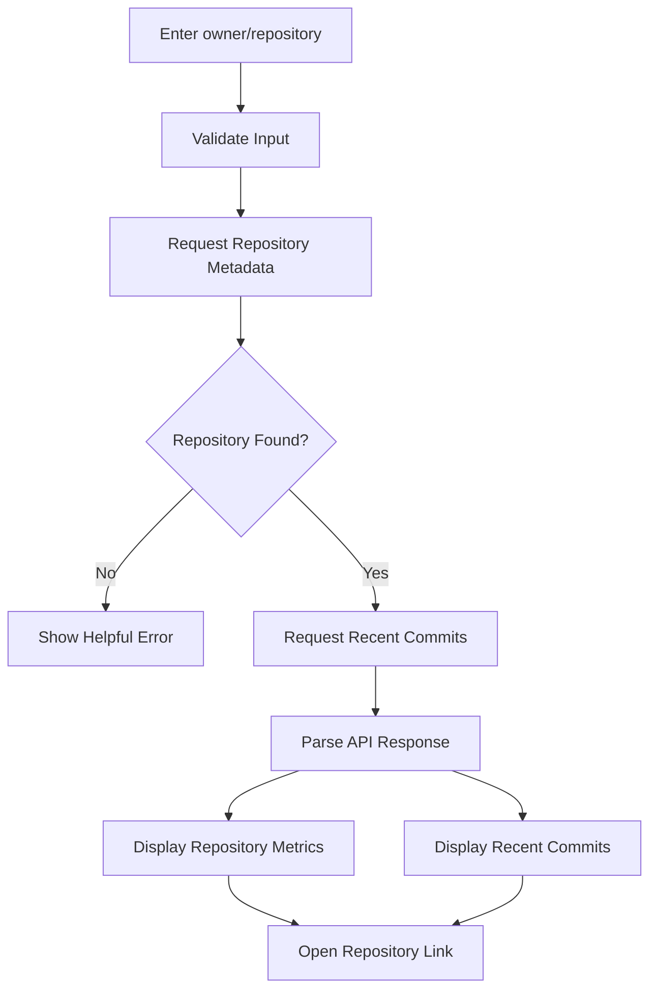
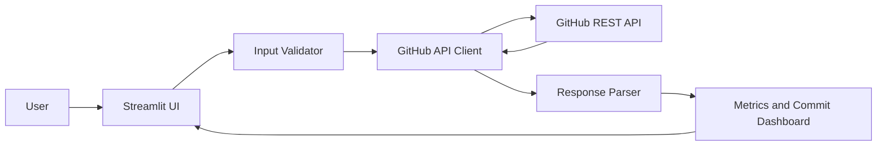

# 🐙 GitHub Repository Analyzer

<p align="center">
  <strong>Explore public repository statistics and recent commit activity.</strong>
</p>

<p align="center">
  
  
  
  
</p>

## 📌 Overview
A dashboard that calls the GitHub REST API to display public repository metadata such as stars, forks, open issues, language, default branch, and recent commits.

## 🧭 Application Flowchart


## 🏗️ Architecture


## 🧰 Technology Stack
| Layer | Technology | Purpose |
|---|---|---|
| UI | Streamlit | Dashboard and input |
| Language | Python | Application logic |
| HTTP client | Requests | Send API requests |
| External API | GitHub REST API | Fetch repository information |
| Configuration | Environment variable | Optional API token |

## ✨ Features
- Search public repositories using `owner/repository`.
- Display stars, forks, open issues, language, branch, and timestamps.
- List recent commit messages, authors, and dates.
- Handle invalid input, missing repositories, and rate limits.
- Optional token support via `GITHUB_TOKEN` environment variable.

## 📂 Project Structure
```text
02-github-repository-analyzer/
├── app.py
├── requirements.txt
├── README.md
└── .gitignore
```

## 🚀 Getting Started
```bash
python -m venv .venv
# Windows: .venv\Scripts\activate
# macOS/Linux:
source .venv/bin/activate
pip install -r requirements.txt
streamlit run app.py
```

## 🔐 Optional API Token
Set `GITHUB_TOKEN` as an environment variable to raise your API rate limit. Never commit tokens or secrets to GitHub.

## ⚠️ Limitations
- Requires internet access.
- Unauthenticated API usage is rate-limited.
- Only public repositories are supported by the intended workflow.

## 🔮 Future Improvements
- Add language breakdown and commit activity charts.
- Compare multiple repositories side by side.
- Add caching and automated API-client tests.
